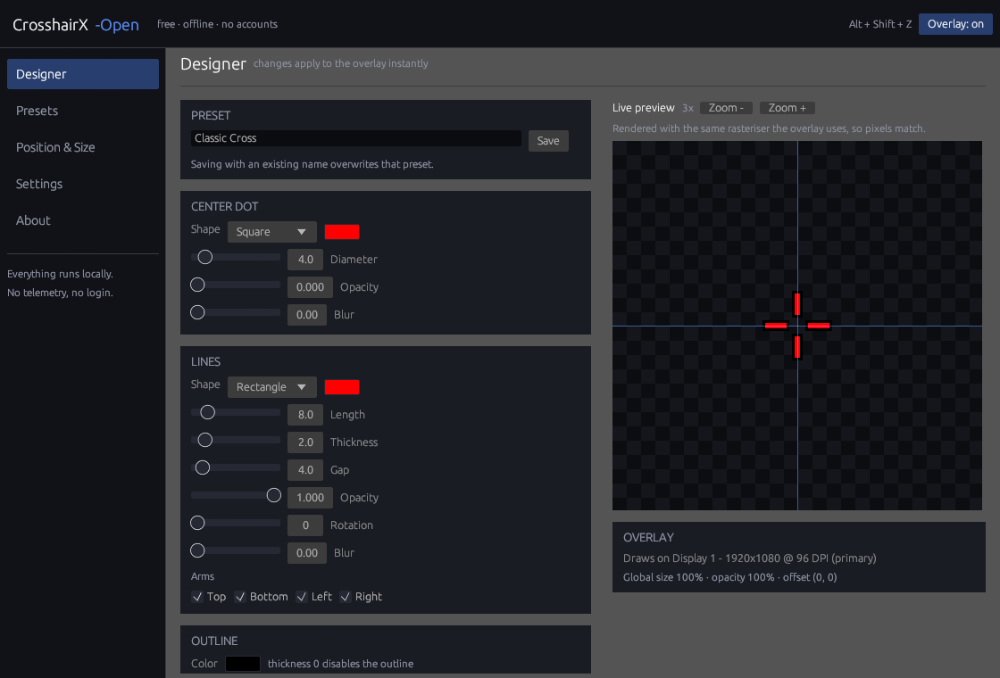

# CrosshairX-Open

A free, open-source replacement for paid crosshair overlay apps on Windows 10 and 11.

CrosshairX-Open draws a transparent, click-through, always-on-top crosshair on top of
your desktop and games. You design it in a live editor, it appears instantly, and it
never talks to the network.



* Open source (MIT), no accounts, no ads, no subscriptions, no telemetry, works offline
* Transparent, click-through, always-on-top overlay (layered Win32 window)
* Custom shapes, colours, sizes, opacity, outlines, gaps and per-layer positioning
* Live editor whose preview is rendered by the same rasteriser as the overlay
* Local preset library with JSON import/export, including the community payload format
  used by the original Crosshair X
* Global hotkeys: toggle the overlay, nudge it pixel by pixel
* Multi-monitor, per-monitor DPI v2, any resolution
* Idle CPU use is effectively zero: the overlay only repaints when something changes

## Contents

| Page | What it does |
| --- | --- |
| Designer | Dot shape/size/colour, four arms with length, thickness, gap, rotation, per-arm visibility, outline, blur, layer offset and scale. |
| Presets | Save, overwrite, duplicate, delete, import and export designs as JSON. |
| Position & Size | Pick the display, offset from its centre, global size and opacity, DPI handling. |
| Settings | Toggle and position hotkeys, nudge step, start with Windows, data folder. |
| About | Version, how it works, links. |

More screenshots: [presets](docs/screenshots/presets-page.png),
[position & size](docs/screenshots/position.png), [settings](docs/screenshots/settings.png),
[about](docs/screenshots/about.png), and the bundled designs rendered by the engine in
[`docs/screenshots/presets/`](docs/screenshots/presets).

## Install

Download `crosshairx-open.exe` from the [latest release](../../releases/latest) and run it.
It is a single self-contained executable; no installer and no admin rights are needed.
Settings and presets live in `%APPDATA%\CrosshairX-Open`.

Windows SmartScreen may warn about an unsigned binary from a new publisher. That is
normal for a fresh open-source project; build it yourself if you prefer.

## Build from source

You need a Rust toolchain (1.88 or newer) and either the MSVC build tools or the
GNU toolchain (`rustup default stable-x86_64-pc-windows-msvc`, or
`rustup default stable-x86_64-pc-windows-gnu` with MSYS2's gcc on `PATH`).

```bash
git clone https://github.com/tokyonocturn/CrosshairX-Open.git
cd CrosshairX-Open
# target/release/crosshairx-open.exe
```

Development commands:

```bash
cargo test --workspace                 # 40 unit tests (geometry, presets, rasteriser)
cargo run                              # open the editor
cargo run -- --self-test               # end-to-end checks, including on-screen tests
cargo run -- --export-previews out/    # render the bundled presets to PNG
cargo run -- --ui-snapshot shot.png    # save a screenshot of the editor window
```

The release executable is built for the Windows GUI subsystem so that double-clicking it
never opens a console window. When you call a command-line flag from PowerShell, wait for
it explicitly (`Start-Process .\crosshairx-open.exe -ArgumentList "--export-previews","out" -Wait`),
because PowerShell does not wait for GUI-subsystem processes on its own. `cmd.exe` and
Git Bash wait normally.

## Using it

Start the app, pick a preset or design your own, and leave it running. The overlay is
click-through, so it never takes mouse input away from the game.

| Shortcut | Action |
| --- | --- |
| `Alt + Shift + Z` | Show/hide the crosshair (configurable in Settings) |
| `Alt + Shift + Arrow keys` | Move the crosshair one pixel (configurable) |

Both shortcuts are registered with `RegisterHotKey`, so they work while a game has
focus and no keyboard hooks are installed.

### Preset files

Presets are plain JSON. `Export current...` writes this project's format:

```json
{
  "format": "crosshairx-open/1",
  "name": "Wide Gap Green",
  "layers": [
    {
      "dot":  { "diameter": 2, "opacity": 1, "color": "#00FF88", "shape": "square", "thickness": 1, "blur": 0 },
      "line": { "length": 10, "thickness": 2, "offset": 6, "opacity": 1, "color": "#00FF88",
                "shape": "rectangle", "rotation": 0, "blur": 0,
                "visible": ["top", "bottom", "left", "right"] },
      "outline": { "thickness": 1, "opacity": 1, "color": "#000000", "blur": 0 },
      "position": { "x": 0, "y": 0 },
      "layer": { "size": 1 }
    }
  ]
}
```

`Import JSON...` also accepts the community payload shape
(`{"crosshairId": [ ... ], "name": "..."}`), arrays of those, and the
`{"items": [...]}` page wrapper, so designs exported from the original app load here.
Unknown fields (such as its `firingOptions`) are ignored rather than rejected.

## How it works

```
crates/crosshair-core   model + geometry + rasteriser + preset library (no OS code)
src/win32.rs            hand-written Win32 bindings (no binding crate)
src/overlay.rs          layered overlay window, message loop, hotkeys
src/ui.rs               egui editor
src/startup.rs          per-user Run key for "start with Windows"
src/selftest.rs         scriptable end-to-end checks
```

* The overlay is a `WS_POPUP` window with `WS_EX_LAYERED | WS_EX_TRANSPARENT |
  WS_EX_TOPMOST | WS_EX_TOOLWINDOW | WS_EX_NOACTIVATE`, blitted with
  `UpdateLayeredWindow` from a 32-bit premultiplied DIB. Only the crosshair's own
  bounding box is covered, not the whole screen.
* `crosshair-core` renders into a premultiplied RGBA pixmap with `tiny-skia`, which is
  exactly what `UpdateLayeredWindow` expects, and the editor preview uploads the same
  pixmap as a texture. What you see in the designer is what the overlay draws.
* Per-monitor DPI v2 awareness; the crosshair is scaled by the selected display's DPI
  unless you tick "ignore display DPI scaling", in which case sizes are physical pixels.
* Nothing polls: the overlay thread blocks in `GetMessage`, and the editor requests a
  repaint only when you change something.

## Verification

`crosshairx-open --self-test` exercises the shipped binary, not a mock. On a machine
with three displays it printed:

```
[info] 3 display(s) detected
       Display 1 - 1920x1080 @ 96 DPI (primary) at (0, 0) ...
[ ok ] preset Classic Cross        30x30 px, 160 non-transparent px
...
[ ok ] preset export/import round-trip (1)
[ ok ] community payload import ('Community Sample', 1 layer(s))
[ ok ] overlay window created (hwnd 0x270936, class 'CrosshairXOpenOverlay')
[ ok ] the crosshair is composited on screen (+234 px)
[ ok ] window style has WS_EX_LAYERED
[ ok ] window style has WS_EX_TRANSPARENT (click-through)
[ ok ] window style has WS_EX_TOPMOST
[ ok ] window style has WS_EX_NOACTIVATE
[ ok ] clicks pass through (WindowFromPoint -> class 'UnityWndClass')
[ ok ] hiding the overlay removes it from the screen
[ ok ] offset moves the crosshair (+192 px at x+20)
[ ok ] display selection moves the crosshair to Display 2 - 1920x1080 @ 96 DPI
[ ok ] global hotkey Alt + Shift + Z toggled the overlay
[ ok ] hotkey hid the overlay from the screen
[ ok ] position hotkey moved the crosshair 1px (x 20 -> 21)
[ ok ] autostart entry written to HKCU Run and read back
[ ok ] autostart entry restored to its previous state (disabled)
[ ok ] stopping the overlay thread tears the window down

=== all checks passed ===
```

The on-screen checks capture the desktop before and after showing the overlay and count
pixels of the exact green the test crosshair uses, so "it renders" means "it is actually
composited on the screen", over whatever window happened to be in front.

`cargo test --workspace` covers the geometry (arm rectangles, gaps, outline frames,
triangle points, rotation, extent, image projection), colour parsing, preset
import/export/round-trip, settings persistence and corruption recovery, and pixel-level
rasteriser behaviour (opacity, hidden arms, dot shapes, hollow rings, blur bleed, layer
transform).

## Resource use

Measured on Windows 11 with the editor window open and the overlay visible
(`tools/measure-idle.ps1`, 16 logical cores, 180 s sample, 15 s buckets):

```
RESULT totalCpuMs=813 avgOneCorePct=0.451 avgMachinePct=0.0282
RESULT avgGpuPct=0.000 maxGpuPct=0.000
```

All 813 ms of CPU time happened in the first 15 seconds (font atlas, GL context and the
preset thumbnails). Every one of the following eleven buckets measured **0.0 ms** of
process CPU time, which is what the design intends: the overlay thread blocks in
`GetMessage` and egui only repaints when something changes, so an idle crosshair costs
nothing between keystrokes. GPU engine utilisation stayed at 0.00% across the whole
sample (18 engine instances were tracked for the process, so this is a real zero rather
than a missing counter); the process held 32 MB of dedicated video memory, 99.6 MB of
working set and 172.7 MB of private commit while idle.

To reproduce it yourself:

```powershell
.\target\release\crosshairx-open.exe
powershell -NoProfile -ExecutionPolicy Bypass -File tools\measure-idle.ps1 -Seconds 180
```

## How this was built

The original Crosshair X installation was inspected first — its Electron archive, its
preset schema, its emitted SVG geometry, its window flags and its default keybinds — so
that this replacement behaves the same way where behaviour is visible to users. No code,
assets, artwork, community content or translations from it were copied; see
[`docs/INSPECTION.md`](docs/INSPECTION.md) for the evidence trail and for what was
deliberately left out.

## Limitations

* Desktop overlays cannot draw over **exclusive fullscreen** (DirectX exclusive) games;
  use windowed or borderless fullscreen, which is what most modern games default to.
  The original app solves this with an Xbox Game Bar extension, which is out of scope here.
* Firing/bloom animations (`firingOptions` in imported presets) are parsed but not
  animated: it needs a global low-level mouse hook, and this build deliberately installs
  no input hooks.
* Sound effects, the Steam Workshop/community browser, accounts and ads from the original
  are intentionally not reproduced.
* HDR displays may shift overlay colours slightly, as with any layered window.
* Overlays of any kind can interact with anti-cheat rules. This app never reads or writes
  game memory and never injects into another process, but use it at your own risk and
  check the rules of the games you play.

## License

MIT. See [LICENSE](LICENSE).
